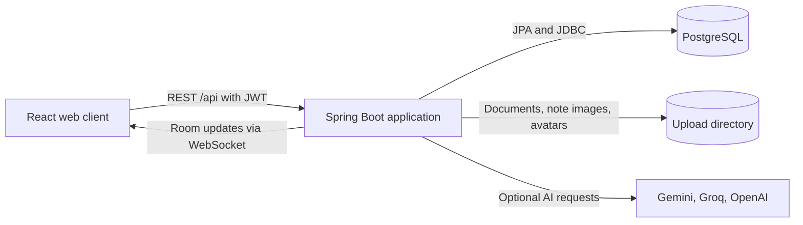

# StudyMate

StudyMate is a web workspace for planning classes, managing assignments, studying course materials, and running solo or shared Pomodoro sessions.

[Installation](#installation) · [Run locally](#running-the-project) · [Configuration](#environment-configuration) · [Deploy](#deployment) · [Contribute](#contribution-guidelines)

## Introduction

StudyMate brings a student's schedule, coursework, and study history into one place. A typical workflow is to create a subject, schedule a class, add an assignment, and attach a focus session to the task. Completed work and recorded focus time feed the dashboard, study streak, and activity charts.

The repository contains a React web client and a Spring Boot API backed by PostgreSQL. The current interface and daily assistant are primarily in Vietnamese.

## Key features

| Feature | What you can do |
| --- | --- |
| Coursework | Organize subjects, tasks, notes, and course documents. View your timetable and export it as an iCalendar file. |
| Focus sessions | Study against a task or subject, or start a free session. Pause, resume, or save elapsed focus time. |
| Study statistics | Review daily activity, study streaks, and progress toward a weekly goal. Filter period statistics by date and subject. |
| Study rooms | Invite classmates by link, follow a shared Pomodoro timer, and exchange text and images, including in the fullscreen focus view. |
| AI study tools | Generate summaries, quizzes, and mind maps from notes or supported documents. Ask questions about an uploaded document. |
| Daily assistant | Ask read-only questions about classes, rooms, and deadlines, such as “Ngày mai có lịch học gì?” |
| Accounts and export | Register with a username and password or use Google sign-in when configured. Download a JSON export of study data from Settings. |

## Overall architecture



- **Web.** React, Vite, and Tailwind CSS power the interface. In development, Vite serves the web client. In the Docker build, Spring Boot serves the compiled client and the API on the same origin.
- **API and data.** Spring Security validates access tokens. PostgreSQL stores accounts, coursework, focus sessions, and study rooms. The server calculates study metrics from confirmed activity and exposes a consistent snapshot through `GET /api/study/overview`.
- **Realtime rooms.** The browser requests a short-lived ticket over REST and uses it to authenticate to `/ws/study-room`. WebSocket events signal changes. The client then fetches the latest room snapshot over REST.
- **Storage and AI.** Course uploads use the configured filesystem directory. Chat images are stored in PostgreSQL. Document text extraction runs on the backend, and configured AI providers handle supported generation requests.

## Installation

Install JDK **21**, Node.js **22.13 or later in the 22.x line** with npm, and **PostgreSQL 16** with `psql` and `createdb` on your path. The Maven Wrapper is included. The Windows examples use PowerShell **7.2 or later**. Docker is optional for local development.

```sh
git clone https://github.com/HuyBeros/StudyMate.git
cd StudyMate
npm --prefix frontend ci
```

### Initialize PostgreSQL

Start PostgreSQL and create a **new, empty** database. The example uses `localhost`, the `postgres` role, and the database name `studymate`. Substitute your own role if needed and use the same credentials when starting the API.

```sh
createdb -h localhost -U postgres studymate
```

From the repository root, run the schema and migrations in one `psql` connection. The baseline includes the earlier account and job tables. Spring Boot validates the schema at startup.

```powershell
$schemaArgs = @(
    '-X', '-v', 'ON_ERROR_STOP=1', '-h', 'localhost', '-U', 'postgres', '-d', 'studymate',
    '-f', 'src/test/resources/db/p1-legacy-schema.sql',
    '-c', "SET search_path TO public; SET studymate.legacy_timezone = 'Asia/Ho_Chi_Minh'",
    '-f', 'src/main/resources/db/migration_003_study_foundation.sql',
    '-f', 'src/main/resources/db/migration_004_username_login.sql',
    '-f', 'src/main/resources/db/migration_005_study_rooms.sql'
)
psql @schemaArgs
```

On Bash or zsh, run the same `psql` options as a single command:

```bash
psql -X -v ON_ERROR_STOP=1 -h localhost -U postgres -d studymate \
  -f src/test/resources/db/p1-legacy-schema.sql \
  -c "SET search_path TO public; SET studymate.legacy_timezone = 'Asia/Ho_Chi_Minh'" \
  -f src/main/resources/db/migration_003_study_foundation.sql \
  -f src/main/resources/db/migration_004_username_login.sql \
  -f src/main/resources/db/migration_005_study_rooms.sql
```

For an existing StudyMate database, back it up and apply only the migrations it is missing. Run them in order and set the legacy time zone before migration 003.

## Running the project

### Development

In the first terminal, set backend environment variables and start Spring Boot from the repository root. Replace the database role if you used a different one during installation.

```powershell
$env:DB_URL = 'jdbc:postgresql://localhost:5432/studymate?stringtype=unspecified'
$env:DB_USERNAME = 'postgres'
$env:DB_PASSWORD = Read-Host 'PostgreSQL password' -MaskInput
$env:JWT_SECRET = [Convert]::ToBase64String([Security.Cryptography.RandomNumberGenerator]::GetBytes(32))
./mvnw.cmd spring-boot:run
```

In Bash or zsh, use the following equivalent. The secret generator uses OpenSSL.

```bash
export DB_URL='jdbc:postgresql://localhost:5432/studymate?stringtype=unspecified'
export DB_USERNAME='postgres'
printf 'PostgreSQL password: '
IFS= read -rs DB_PASSWORD
printf '\n'
export DB_PASSWORD
export JWT_SECRET="$(openssl rand -base64 32)"
sh ./mvnw spring-boot:run
```

In a second terminal, start the web client:

```sh
npm --prefix frontend run dev -- --port 5173 --strictPort
```

Open **http://localhost:5173**. Register a local account, add a subject and a task, then start a focus session. The API listens on **http://localhost:8080** by default.

### API example

After creating a local account, use its credentials to retrieve the study snapshot. This PowerShell example stores the access token in memory.

```powershell
$username = Read-Host 'StudyMate username'
$password = Read-Host 'StudyMate password' -MaskInput
$body = @{ username = $username; password = $password } | ConvertTo-Json
$login = Invoke-RestMethod -Method Post -Uri 'http://localhost:8080/api/auth/login' -ContentType 'application/json' -Body $body
$headers = @{ Authorization = "Bearer $($login.data.accessToken)" }
Invoke-RestMethod -Uri 'http://localhost:8080/api/study/overview' -Headers $headers
```

### Deployment

The [Dockerfile](Dockerfile) builds the web client with `VITE_API_BASE_URL=/api` and packages it with Spring Boot. On Render, create a Docker Web Service from the repository root. Initialize PostgreSQL before starting the container, then set the [environment variables](#environment-configuration), including `FRONTEND_URL` for room connections. Mount a persistent disk at the configured `UPLOAD_DIR` to retain uploaded files across deploys.

For Neon, initialize the schema over a direct connection and configure `DB_URL` as `jdbc:postgresql://<neon-host>:5432/<database>?sslmode=require&channelBinding=require&stringtype=unspecified`. Set `DB_USERNAME` and `DB_PASSWORD` separately in the hosting environment. [Neon JDBC setup](https://neon.com/docs/guides/java)

For local testing of a bundled build, run `npm --prefix frontend run build` before packaging or starting Spring Boot. The build copies generated files into the backend's static resources directory.

> Run a single application instance because WebSocket connections and tickets live in memory. Course uploads are served under `/uploads/**` by URL. Use sample documents in a public demo and add authenticated file access before accepting private material.

## Environment configuration

Pass backend variables to the Java process through the shell, your IDE, or your hosting dashboard. The root [environment template](.env.example) lists common values. Load its values into the process when you use it for local development.

| Variable | Purpose | Example or default |
| --- | --- | --- |
| `DB_URL` | PostgreSQL JDBC URL. Keep `stringtype=unspecified` for PostgreSQL enum mappings. | `jdbc:postgresql://localhost:5432/studymate?stringtype=unspecified` |
| `DB_USERNAME` | Database role used by Spring Boot. | `postgres` locally |
| `DB_PASSWORD` | Password for the database role. | Set for your database |
| `JWT_SECRET` | JWT signing secret. Use a stable, random value of at least 32 bytes per environment. | Generate as shown above |
| `FRONTEND_URL` | Allowed web origin for CORS and room WebSockets. Use the exact scheme, host, and port with no trailing slash. | `http://localhost:5173` |
| `PORT` | HTTP port for Spring Boot. | `8080` |
| `UPLOAD_DIR` | Directory for course documents, note images, and avatars. Use persistent storage when hosted. | `uploads` |
| `STUDY_LEGACY_TIMEZONE` | Time zone for legacy task timestamps. Match the value used during migration 003. | `Asia/Ho_Chi_Minh` |
| `GOOGLE_CLIENT_ID` | Optional Google web client ID. Register the web origin with the OAuth client. | Your Google web client ID |
| `GOOGLE_CLIENT_IDS` | Optional comma-separated list of accepted Google client IDs. | Defaults to `GOOGLE_CLIENT_ID` |
| `GEMINI_API_KEY`, `GROQ_API_KEY`, `OPENAI_API_KEY` | Optional backend credentials for AI providers. Set the keys for the providers you use. | Unset |

The web client defaults to `http://localhost:8080/api`. To override it, copy [frontend/.env.example](frontend/.env.example) to `frontend/.env` and set `VITE_API_BASE_URL`. Keep database credentials, signing keys, and provider keys in the backend environment because `VITE_` variables are exposed in the web bundle.

## Folder structure

```text
StudyMate/
├── frontend/
│   ├── src/                     React screens, hooks, API client, and locales
│   ├── public/                  Web icons and other public assets
│   └── tests/                   Web tests and preview fixtures
├── src/
│   ├── main/
│   │   ├── java/com/huyberos/studymate/
│   │   │   ├── controller/      REST controllers
│   │   │   ├── service/         Coursework, authentication, and AI workflows
│   │   │   ├── repository/      Database access
│   │   │   └── study/, room/, assistant/, ai/
│   │   └── resources/db/        Versioned SQL migrations
│   └── test/                    Backend tests and database fixtures
├── contracts/metrics-v1/        Shared fixtures for study metrics
├── scripts/                     Local demo and test database utilities
├── Dockerfile                   Builds the web and API into one image
└── pom.xml                      Backend build and dependencies
```

## Contribution guidelines

1. For a substantial change, open an issue describing the problem and the expected behavior.
2. Create a branch such as `fix/room-reconnect`. Keep the pull request focused and include reproduction steps or screenshots when relevant.
3. Keep business rules in services or the relevant domain package. Preserve API response shapes and ownership checks. Document schema changes and validate them on a fresh database.
4. Run the checks below. In the pull request, describe what changed, how you verified it, and whether deployment or migration steps are required.

```sh
npm --prefix frontend test
npm --prefix frontend run lint
npm --prefix frontend run build
```

Backend integration tests expect a separate PostgreSQL instance at `127.0.0.1:55438`. On Windows, initialize it with the included helper and replace the example path with your PostgreSQL `bin` directory:

```powershell
./scripts/setup-p1-test-db.ps1 -PgBin 'C:/Program Files/PostgreSQL/16/bin'
./mvnw.cmd test
```

On other platforms, configure a dedicated test instance using [the test settings](src/test/resources/application.properties) and the [schema setup](#initialize-postgresql), then run `sh ./mvnw test`. Keep generated bundles, local credentials, and uploaded files outside commits.

## License

The repository currently has no project-level license. Contact the repository owner for permission to reuse or redistribute the project.

## Roadmap

| Area | Planned work |
| --- | --- |
| Reliability | Private document access, durable upload storage, and tested backup and restore. |
| Cross-device study | Incremental sync, offline editing and conflict handling, and a Flutter Android client. |
| AI-assisted learning | Answers with page or slide citations and spaced-repetition review. |
| Academic workflows | Grade and GPA tracking, plus two-way calendar integration. |
| Collaboration | Persistent study groups and room updates across application instances. |
