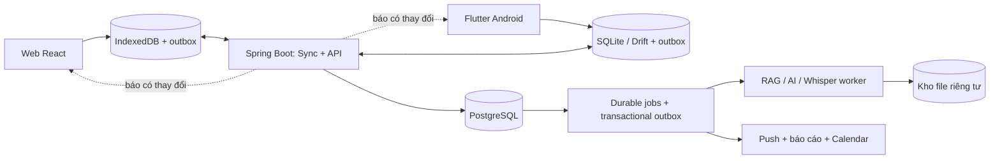

# StudyMate — Kế hoạch thiết kế và triển khai sản phẩm

Ngày lập: 04/11/2026. Trạng thái: đề xuất để triển khai, chưa phải các tính năng đã hoàn thành.

Ràng buộc đã chốt: **một người triển khai; ứng dụng di động bằng Flutter; giữ web React hiện có; dùng chung backend Spring Boot/PostgreSQL**. Android là nền tảng di động phát hành đầu tiên. Cấu trúc Flutter hỗ trợ mở rộng iOS, nhưng kiểm thử, push, quyền hệ thống và phát hành iOS là công việc riêng, chưa nằm trong ước lượng Android dưới đây.

## 1. Hiện trạng và khoảng trống

| Hạng mục | Đã có trong mã nguồn | Phần cần làm |
|---|---|---|
| Môn học, nhiệm vụ, lịch, ghi chú | Entity, API và giao diện web | Phiên bản dữ liệu, đồng bộ offline, trải nghiệm Flutter |
| Chuỗi ngày học, giờ tập trung | Ba trang web dùng chung `buildStudyMetrics`; phiên và mục tiêu còn lưu theo thiết bị | Nguồn dữ liệu chuẩn trên server, chuyển dữ liệu cũ và đối soát đa thiết bị |
| Google | Giao diện và endpoint OAuth; JWT, refresh-token rotation | Xác minh token Google; định danh theo `sub`; liên kết tài khoản an toàn |
| AI theo tài liệu | Upload PDF/DOCX/PPTX, hỏi đáp, tóm tắt, quiz, mindmap, `AiRouter`, async jobs | Truy xuất theo môn, trích dẫn có trang/slide, đánh giá chất lượng, retry bền vững |
| Trích xuất tài liệu | PDFBox/POI, hiện gom thành chuỗi văn bản | Giữ trang/slide và phiên bản; OCR; báo lỗi thật khi không trích xuất được |
| Nhập thời khóa biểu | Backend đã nhận ảnh và có bước preview/confirm, kiểm tra trùng | Cải thiện ảnh khó đọc; đọc Excel có ánh xạ cột và xác nhận trước khi lưu |
| Offline và Android | Web responsive; dữ liệu cục bộ có giới hạn; chưa thấy dự án Android/Flutter trong checkout | Repository đọc từ DB cục bộ, outbox, sync protocol, app Flutter |
| Thông báo | Thông báo trong web và nhắc khi ứng dụng mở | Push, nhắc cục bộ, lịch gửi trên server, chống gửi trùng |
| Cộng tác, GPA, SRS, phiên ghi âm | Chưa thấy mô-đun tương ứng | Thiết kế dữ liệu, luồng và triển khai theo các giai đoạn sau |

Các việc cần xử lý trước khi mở rộng:

- `AuthService.oauth2Login()` hiện lấy email client gửi lên rồi cấp JWT; hàm này chưa xác minh token Google. Đưa việc sửa và kiểm thử giả mạo danh tính vào P0.
- `TextExtractorService` hiện có nhánh dùng tên file làm nội dung thay thế khi không đọc được tài liệu. Với RAG phải trả trạng thái lỗi/OCR, không xem tên file là kiến thức đã trích xuất.
- `OfflineFallbackProvider` hiện tạo tóm tắt/quiz mẫu khi provider lỗi. Loại khỏi đường xử lý production; mất mạng chỉ cho đọc kết quả đã lưu hoặc xếp yêu cầu chờ xử lý.
- Rà soát quyền sở hữu theo `subjectId`, `documentId`, `noteId`, `jobId`, đường tải file. Kiểm tra whitelist `/uploads/**` trước khi đưa tài liệu riêng tư hoặc nhóm lên hệ thống.

Tệp tham chiếu trong dự án: `frontend/src/lib/studyMetrics.js`, `frontend/src/hooks/useStudyPreferences.js`, `service/DashboardService.java`, `service/AuthService.java`, `service/TextExtractorService.java`, `service/ScheduleImportService.java`, `ai/AiRouter.java`, `ai/OfflineFallbackProvider.java` dưới package hiện tại.

## 2. Kiến trúc chung

Giữ backend dạng **modular monolith** để một người có thể vận hành. Chia package theo miền: identity, study, sync, content, ai, review, planning, notifications, academics, collaboration. Chỉ tách worker xử lý file/âm thanh khi cần thư viện hoặc tài nguyên khác Java.

Các quyết định đề xuất:

| Lớp | Phương án |
|---|---|
| Web | React/Vite/Tailwind hiện tại; thêm repository và IndexedDB; service worker cache app shell và tài liệu người dùng chọn tải |
| Di động | Flutter; tổ chức UI → ViewModel → Repository; Drift/SQLite cho dữ liệu và outbox; nơi lưu token dùng cơ chế bảo vệ của hệ điều hành |
| Server | Spring Boot/Java/PostgreSQL hiện có; thêm metrics service, sync service, durable jobs |
| Đồng bộ đang mở app | REST để ghi/đọc thay đổi; SSE phát tín hiệu có revision mới; có polling dự phòng khi kết nối bị chặn |
| Đồng bộ nền | Flutter dùng cơ chế background work thích hợp Android; đồng bộ lại khi mở app/kết nối trở lại; web không phụ thuộc hoàn toàn vào background sync |
| Push | FCM cho Flutter Android và web; không chuyển nguồn dữ liệu sang Firestore |
| File | Kho object storage tương thích S3 hoặc dịch vụ tương đương; URL tải có hạn, kiểm tra quyền tại server |
| Tìm kiếm tài liệu | Đánh giá PostgreSQL full-text + vector index trong POC; chỉ chốt extension sau khi kiểm tra hạ tầng |
| AI | Giữ `AiRouter`; ghi provider/model/prompt version, timeout, chi phí; không tự chuyển tài liệu sang provider chưa được cấu hình cho phép |

Đưa cấu hình môi trường vào nền tảng: API base URL riêng dev/staging/production, HTTPS cho bản triển khai, CORS cho web, cấu hình service worker/push và deep link Android. `localhost` của điện thoại không phải máy chạy backend; Flutter phải dùng địa chỉ môi trường cấu hình. Kho cache có quản lý dung lượng, cảnh báo lỗi ghi/thiếu chỗ và tùy chọn tải tài liệu; không hứa browser không bao giờ thu hồi dữ liệu cache.

Flutter đề xuất Repository làm điểm truy cập và sửa dữ liệu thống nhất, kết hợp nguồn cục bộ và từ xa. Drift cung cấp truy vấn phản ứng và hỗ trợ migration cho SQLite. Đây là cơ sở cho lựa chọn trên, không phải một sync engine có sẵn. [Flutter offline-first](https://docs.flutter.dev/app-architecture/design-patterns/offline-first), [Drift](https://drift.simonbinder.eu/).

## 3. Hợp đồng dữ liệu cho streak, giờ học và tiến độ

### 3.1. Một nơi xác nhận số liệu

PostgreSQL giữ dữ liệu đã được server chấp nhận. `StudyMetricsService` tính cùng một snapshot cho Dashboard, Statistics, Profile, báo cáo và huy hiệu. Client không tự lưu một biến `streak` riêng trong hồ sơ.

- Giờ học lấy từ khoảng thời gian tập trung thực tế đã lưu; loại thời gian nghỉ/tạm dừng. Không lấy từ lịch học dự kiến hoặc hạn nộp.
- Tiến độ nhiệm vụ = số nhiệm vụ DONE / số nhiệm vụ thuộc đúng phạm vi lọc. Phạm vi hôm nay, tuần và toàn môn phải ghi rõ. Không có nhiệm vụ → trạng thái chưa có mục tiêu.
- Tiến độ môn trong V1 là tiến độ nhiệm vụ, chưa gọi là mức độ hiểu kiến thức.
- Heatmap lấy từ cùng hoạt động được dùng để xác định ngày học, có tooltip phân biệt số nhiệm vụ, phiên và lần ôn.
- API trả `asOf`, `metricsVersion`, `syncRevision`, timezone và phạm vi ngày/môn để client biết số liệu có cùng mốc hay chưa.

Khi offline, mỗi client có bản sao và thay đổi chờ gửi. Cho phép hiển thị ước tính từ cùng đặc tả tính toán, kèm nhãn **“Có dữ liệu chưa đồng bộ”**. Không cam kết hai máy đang mất mạng luôn có cùng số; tiêu chí là hội tụ về cùng số sau khi đồng bộ.

### 3.2. Quy tắc nghiệp vụ V1 cần chốt trước khi lập trình

| Chỉ số | Quy tắc đề xuất |
|---|---|
| Ngày học hợp lệ | Hoàn thành một nhiệm vụ; hoặc phiên có ít nhất 10 phút tập trung; khi có SRS, hoàn thành ít nhất 5 lượt ôn hợp lệ trong ngày |
| Chuỗi ngày học | Đếm ngày hợp lệ liên tiếp; nếu hôm nay chưa học thì giữ chuỗi đến hết ngày nếu hôm qua hợp lệ |
| Giờ tập trung | Tổng thời gian hoạt động của phiên, kể cả phiên dừng sớm được người dùng chọn lưu; không cộng giờ nghỉ |
| Nhiệm vụ liên kết | Phiên gắn `taskId`; môn được lấy từ nhiệm vụ và lưu snapshot, không tự đổi lịch sử khi nhiệm vụ chuyển môn |
| Hai máy cùng chạy phiên | Cảnh báo và đối soát khoảng trùng; không cộng chồng hai lần. Phiên có xung đột cần chọn cách phân bổ môn trước khi chốt |
| Freeze streak | Chỉ nối chuỗi theo chính sách, không tạo giờ học hoặc ô hoạt động giả; ngày được bảo vệ có ký hiệu riêng |
| XP | Chỉ cấp một lần theo định danh hoạt động; mở lại/hoàn thành lại một nhiệm vụ không tạo XP vô hạn |

Ngưỡng 10 phút/5 lượt ôn là **đề xuất sản phẩm**, chưa phải yêu cầu đã được người dùng chốt. Đóng băng thành `metricsVersion` sau P0; không âm thầm thay quy tắc giữa hai client.

### 3.3. Dữ liệu và chuyển đổi

- Thêm `study_session`, `study_session_segment`, lịch sử chuyển trạng thái nhiệm vụ, `user_study_preferences`, `daily_activity_projection` và sổ sự kiện thưởng sau này.
- Thời điểm sự kiện lưu UTC với timezone gốc; ngày/tuần học dùng timezone tài khoản, mặc định đề xuất `Asia/Ho_Chi_Minh`.
- Phiên qua nửa đêm được chia thời lượng theo ngày; chỉ những ngày đủ ngưỡng mới duy trì streak. Chốt cách đổi timezone để không tạo ngày học trùng khi đi lại.
- Dữ liệu cũ đang dùng `LocalDateTime`: xác nhận timezone lúc ghi trước khi migration; không tự giả định mọi timestamp cũ là UTC.
- Nhập phiên Pomodoro và mục tiêu từ localStorage đúng tài khoản, một lần theo public ID/idempotency key; chỉ đánh dấu đã chuyển khi server xác nhận. Giữ bản cũ để đối soát.
- Không suy đoán ngày hoàn thành cho nhiệm vụ thiếu `completedAt`, không dựng lại lịch sử từ lịch học.
- Java, JavaScript, Dart dùng bộ fixture JSON chuẩn chung để kiểm tra cùng quy tắc; server quyết định số liệu đã xác nhận.

## 4. Đồng bộ và offline-first

### 4.1. Giao thức

1. Mỗi thao tác ghi entity và mutation vào cùng transaction DB cục bộ, rồi UI đọc lại từ DB.
2. Mutation chứa `mutationId`, public ID entity, `baseVersion`, patch, `deviceId`, client timestamp và các phụ thuộc. Danh tính người dùng lấy từ token, không lấy từ body.
3. Server kiểm tra quyền, khử trùng mutation, kiểm tra version; ghi dữ liệu, change log và outbox trong cùng transaction.
4. Client nhận ACK theo mutation và mapping public ID; pull thay đổi theo cursor; chỉ cập nhật cursor sau khi ghi thành công cả trang vào DB cục bộ.
5. Client khác nhận tín hiệu revision mới rồi pull. Khi reconnect/mở lại app vẫn phải pull dù đã mất tín hiệu SSE/push.
6. Retry có backoff; 401 yêu cầu phục hồi đăng nhập, 409 đi vào luồng xung đột; không lặp retry mù.

Entity Java vẫn dùng khóa chính sequence theo quy ước dự án; thêm `public_id UUID UNIQUE` để client tạo entity khi offline. Không thay toàn bộ primary key hiện có.

Cursor phải có thứ tự an toàn khi transaction commit: dùng revision theo tài khoản được tuần tự hóa trong transaction, hoặc cơ chế tương đương đã kiểm chứng. Không dùng `updatedAt > lần_đồng_bộ_cuối` làm giao thức vì có thể bỏ sót thay đổi.

### 4.2. Xung đột

| Tình huống | Cách giải quyết |
|---|---|
| Retry cùng mutation | Trả lại kết quả cũ; không tạo thêm nhiệm vụ/phiên/XP |
| Hai máy sửa hai trường độc lập | Merge nếu có thể chứng minh trường không đổi kể từ base version |
| Hai máy sửa cùng nội dung ghi chú | Giữ cả hai bản; màn hình so sánh “Bản trên máy / Bản đã đồng bộ”; cho chọn hoặc lưu thành hai ghi chú |
| DONE trên web, TODO trên điện thoại | Báo xung đột trạng thái; không dùng giờ máy để âm thầm quyết định |
| Một nơi xóa, một nơi sửa | Giữ tombstone và bản sửa chờ; không tự làm sống lại bản xóa; cho khôi phục thành bản mới nếu có quyền |
| Hai lượt ôn cùng thẻ | Lưu review log độc lập; sắp thứ tự xác định và tính lại trạng thái SRS; không lấy `nextReviewAt` cuối cùng ghi đè |
| Cursor quá cũ | Full resync nhưng bảo toàn outbox/bản nháp chưa ACK; rebase và xử lý xung đột |

Xóa mềm/tombstone có thời hạn giữ được công bố, sau đó client quá cũ phải resync. Trạng thái giao diện: đã đồng bộ, chờ gửi, mất mạng, lỗi đăng nhập, cần giải quyết xung đột.

### 4.3. Phạm vi hoạt động khi mất mạng

| Hoạt động | Offline |
|---|---|
| Xem/sửa nhiệm vụ, ghi chú, lịch đã tải | Có; lưu cục bộ và chờ sync |
| Pomodoro gắn nhiệm vụ, lưu phiên | Có; khôi phục trạng thái sau app restart; đối soát khi online |
| Xem tài liệu | Có nếu đã chọn tải và tải xong; hiển thị dung lượng và cho xóa cache |
| Ôn flashcard | Có với bộ thẻ đã tải; review log chờ sync |
| Hỏi AI, sinh thẻ mới, OCR/transcribe | Cần mạng/worker; lưu yêu cầu chờ nếu người dùng chọn |
| Phòng học và chat nhóm | Xem cache được; đồng bộ trực tiếp cần mạng, phòng báo đang mất kết nối |
| Thiết bị mới chưa đăng nhập/tải dữ liệu | Không hứa có dữ liệu hoặc đăng nhập Google khi offline |

Mục tiêu nghiệm thu đề xuất: hai client đang foreground, kết nối ổn định nhận thay đổi trong 5 giây ở ít nhất 95% mẫu đo trong môi trường kiểm thử đã định nghĩa. Đồng bộ nền phụ thuộc hệ điều hành, không hứa thời gian thực khi app bị force-stop. [Android offline-first](https://developer.android.com/topic/architecture/data-layer/offline-first).

## 5. Đăng nhập, sao lưu và thông báo

### 5.1. Google và tài khoản

Web dùng Google Identity Services; Flutter dùng plugin chính thức `google_sign_in`, gửi ID token về backend. Server kiểm tra chữ ký, issuer, audience, hạn dùng và các điều kiện của luồng; định danh Google bằng `sub`. Không tự ghép tài khoản chỉ vì body có cùng email. Tài khoản LOCAL muốn liên kết phải xác thực quyền sở hữu qua phiên đăng nhập hiện tại hoặc luồng xác minh phù hợp. [Google token verification](https://developers.google.com/identity/gsi/web/guides/verify-google-id-token), [Flutter Google Sign-In](https://pub.dev/packages/google_sign_in).

- Mỗi thiết bị có phiên và khả năng thu hồi riêng; giữ refresh rotation, bổ sung phát hiện reuse và luồng đăng xuất mọi thiết bị.
- Web ưu tiên refresh cookie HttpOnly/Secure/SameSite phù hợp kiến trúc cùng origin và có cơ chế CSRF tương ứng; mobile giữ refresh token trong secure storage.
- Đăng xuất offline phải hỏi cách giữ/xóa thay đổi chưa sync; không xóa outbox âm thầm. Cache phân tách theo account, đóng DB tài khoản cũ khi chuyển account.
- Một tài khoản xuyên nền tảng không có nghĩa tự cấp quyền Calendar hoặc mọi thiết bị không bao giờ cần xác thực lại.

### 5.2. Sao lưu và xuất dữ liệu

Phân biệt ba việc: đồng bộ để dùng nhiều máy; backup hệ thống để phục hồi sự cố; export cá nhân để người dùng mang dữ liệu đi.

- Backup DB và kho file theo lịch, mã hóa, retention và kiểm tra restore. Mục tiêu ban đầu đề xuất RPO 24 giờ, RTO 24 giờ; đo lại sau diễn tập.
- Export cá nhân: ZIP gồm JSON có schema version, ghi chú Markdown, CSV nhiệm vụ/phiên/điểm, lịch ICS, file gốc và manifest/checksum. Không xuất token hoặc secret.
- Giao diện có phạm vi xuất, dung lượng ước tính, trạng thái tạo bản xuất và link tải hết hạn.
- Restore/import cá nhân thực hiện qua preview, báo bản trùng và quyền sở hữu; không xóa đè toàn bộ dữ liệu. Đưa bản tối thiểu có vòng export→restore kiểm thử vào gate nền tảng.

### 5.3. Push và nhắc học

- Server lưu lịch nhắc, timezone, quiet hours, thiết bị, tùy chọn từng loại thông báo và lịch sử gửi.
- Các loại V1: hạn nộp, buổi học sắp tới, nhắc học theo giờ, nguy cơ mất streak. Sau SRS thêm nhắc ôn; sau báo cáo thêm báo cáo tuần.
- Chỉ đăng ký push sau khi giải thích lợi ích và người dùng cấp quyền. Từ chối quyền vẫn dùng ứng dụng bình thường.
- FCM đánh thức/báo có thay đổi; dữ liệu bền vững vẫn nằm ở server. Android cần nhắc cục bộ cho lịch đã tải, kết hợp hủy/đổi lịch khi deadline thay đổi.
- Dùng `notificationId + occurrence + deviceId` để tránh trùng local/push; loại thông báo hết hạn, hủy khi đã hoàn thành. Có nút đánh dấu đọc và deep link đúng nhiệm vụ/môn.
- Không hứa push luôn đến đúng giây. Có thử nghiệm mất mạng, token thay đổi, Doze, reboot, quyền bị thu hồi và app bị dừng. [FCM Flutter](https://firebase.google.com/docs/cloud-messaging/flutter/get-started).

## 6. Thiết kế trải nghiệm và hệ thống giao diện

### 6.1. Điều hướng

Giữ 5 mục hiện có trong bản nền tảng: **Trang chủ – Môn học – Lịch học – Thống kê – Hồ sơ**. Web dùng sidebar; Flutter dùng thanh dưới. Hỏi AI nằm trong môn học để luôn rõ phạm vi tài liệu.

Khi phát hành SRS, thử nghiệm phương án **Trang chủ – Môn học – Ôn tập – Lịch học – Cá nhân**; Thống kê vẫn truy cập từ Trang chủ/Cá nhân. Chỉ đổi sau kiểm thử tìm đường, không tự thêm 7–8 nút ở thanh dưới. Nhóm học đặt trong môn hoặc mục quản lý thuộc Cá nhân ở giai đoạn cộng tác.

### 6.2. Màn hình cần thiết kế

| Màn hình/luồng | Nội dung ưu tiên và thao tác chính |
|---|---|
| Trang chủ | Việc cần làm hôm nay → một việc nên bắt đầu → phiên đang chạy/tiến độ tuần; về sau thêm thẻ đến hạn ôn và buổi học kế tiếp |
| Chi tiết nhiệm vụ | Mô tả, môn, hạn, ưu tiên, trạng thái, thời lượng đã học; CTA “Tập trung cho nhiệm vụ này” |
| Trung tâm đồng bộ | Lần sync cuối, số thay đổi chờ, lỗi từng mục, retry; so sánh hai phiên bản khi xung đột |
| Môn học | Tổng quan, tài liệu, ghi chú, nhiệm vụ; AI/ôn tập/điểm mở theo giai đoạn |
| Hỏi AI | Tài liệu nguồn và trạng thái index; hội thoại, trích dẫn bấm mở đúng trang; nút lưu thành ghi chú/thẻ |
| Tạo thẻ/quiz | Chọn nguồn và phạm vi trang → tạo bản nháp → xem nguồn, sửa, bỏ câu lỗi → lưu |
| Ôn tập | Một thẻ/câu mỗi lượt, lật/xem đáp án; Quên/Khó/Được/Dễ; tổng kết và lịch ôn tiếp theo |
| Ghi âm/bài giảng | Ghi âm hoặc tải file → xử lý theo bước → transcript có mốc thời gian → sửa → ghi chú cấu trúc |
| Kế hoạch ôn | Hạn thi, độ khó, quỹ giờ → xem đề xuất trên lịch → sửa và chấp nhận; xem diff khi điều chỉnh |
| Nhập TKB | Ảnh/Excel → ánh xạ nếu cần → preview từng dòng và cảnh báo → xác nhận lưu |
| Thống kê/báo cáo | Giờ thực tế, so sánh kỳ trước, môn ít được học, giờ tập trung cao; phân biệt dữ liệu xác nhận/chờ sync |
| Điểm/GPA | Điểm thành phần, trọng số, tín chỉ, quy chế; phần mô phỏng điểm thi không sửa điểm thật |
| Nhóm/phòng | Thành viên và vai trò, tài liệu/nhiệm vụ chia sẻ, chat; trạng thái phòng và quyền điều khiển timer |
| Hồ sơ/cài đặt | Mục tiêu, nhắc học, kết nối Google/Calendar, thiết bị, offline cache, xuất/khôi phục và quyền riêng tư |

### 6.3. Quy tắc thiết kế chung

- Tiếng Việt và viết hoa đầu câu; thống nhất thuật ngữ “Chuỗi ngày học”, “Giờ tập trung”, “Đã đồng bộ”.
- Dùng nền trung tính, xanh dương cho hành động chính; màu môn do người dùng chọn. Đỏ chỉ lỗi/quá hạn. Biểu đồ có thang màu tăng đơn điệu và không chỉ dựa vào màu.
- Token ba lớp: primitive → semantic → component; dùng cùng tệp token thiết kế cho React và Flutter, có mapping đơn vị CSS px/Flutter logical pixel, không sao chép mù giá trị.
- Thiết kế sáng/tối; text thường đạt tương phản tối thiểu 4.5:1; focus rõ; nhãn truy cập cho biểu tượng; vùng chạm mục tiêu tối thiểu 48 logical pixel trên mobile.
- Mỗi component có mặc định/loading/empty/error/offline/pending/conflict/disabled/success khi phù hợp. Không dùng mock để lấp trạng thái trống.
- Trên mobile, một cột, CTA chính trong vùng dễ chạm, hỗ trợ bàn phím và cỡ chữ lớn; thử 360px trở lên và tablet.
- Với AI, “đang tìm trong tài liệu”, “chưa đủ nguồn”, “xử lý thất bại” là các trạng thái khác nhau; không hiển thị phần trăm tiến độ giả.
- Hiệu ứng hoàn thành ngắn, có thể tắt/reduced motion; không ép bảng xếp hạng hoặc tạo áp lực bằng thông báo.

Đầu ra thiết kế mỗi epic: flow, wireframe web/mobile, bản sáng/tối cho màn hình chính, bảng trạng thái, hợp đồng dữ liệu và checklist nghiệm thu. Wireframe được kiểm thử trước khi đầu tư ảnh hi-fi cho toàn bộ sản phẩm.

## 7. Đặc tả các nhóm tính năng

### Nhóm 2 — AI theo nội dung học

**AI-01. Hỏi đáp theo môn và trích dẫn.** Tải file → quét/kiểm tra → trích trang/slide/đoạn ghi chú → OCR nếu cần → chunk/index → retrieval có lọc quyền và môn → trả lời có nguồn. Mỗi trích dẫn chứa document ID, document version, chunk ID, số trang/slide hoặc mốc thời gian; server kiểm tra trích dẫn nằm trong nguồn đã truy xuất. Chạm nguồn mở đúng vị trí. Ghi chú dùng heading/block, không bịa số trang. Nếu PDF scan không đọc được hoặc không đủ bằng chứng thì thông báo rõ. Tài liệu đổi/xóa phải vô hiệu index cũ theo chính sách.

Nội dung file là dữ liệu tham khảo, không phải chỉ thị cho agent: thử nghiệm tài liệu chứa prompt injection và yêu cầu truy cập môn/tài khoản khác. Lọc quyền trước retrieval và kiểm tra lại khi mở citation; đặt quota/job limit cho mỗi tài khoản để kiểm soát chi phí.

**AI-02. Flashcard, quiz và SRS.** Tái sử dụng quiz hiện có nhưng chuẩn hóa câu hỏi, đáp án, giải thích và nguồn. AI chỉ tạo bản nháp; người dùng duyệt trước khi thêm vào bộ thẻ. SRS tính lịch bằng thuật toán xác định, không hỏi LLM mỗi lần quyết định ngày ôn. POC FSRS trên Dart/JS/server, chốt phiên bản và fixture xuyên nền tảng; dùng tham số mặc định trước khi có đủ review history. Lưu review event và phiên bản thẻ để xử lý hai máy ôn cùng lúc. Mục tiêu retention là cấu hình, không cam kết nhớ chính xác một tỷ lệ. [Open Spaced Repetition / FSRS](https://github.com/open-spaced-repetition).

**AI-03. Tóm tắt bài giảng.** Ghi âm hoặc tải file được phép xử lý → upload tiếp tục được → tách audio/chia đoạn → worker Whisper → transcript có timestamp → chỉnh transcript → tóm tắt theo mục: ý chính, khái niệm, ví dụ, câu hỏi, việc cần làm. Cho bấm về đoạn âm thanh gốc. Người dùng xem dung lượng/thời lượng, quyền ghi âm, trạng thái xử lý và xóa file gốc theo lựa chọn. Worker độc lập có job lease/retry để restart không làm mất bài. Benchmark tiếng Việt và thuật ngữ môn trước khi chốt cấu hình; không tự nhận diện người nói hay suy ra danh tính. [Whisper transcription source](https://github.com/openai/whisper/blob/main/whisper/transcribe.py).

**AI-04. Lập kế hoạch ôn.** Người dùng nhập lịch thi, phạm vi, độ khó, khung giờ rảnh, giới hạn học/ngày và thời gian nghỉ. Bộ xếp lịch xác định xử lý ràng buộc cứng; AI gợi ý chia nội dung và giải thích. Bản đề xuất luôn cho xem/sửa/chấp nhận trước khi tạo lịch. Khi trễ tiến độ, chỉ dời phần chưa hoàn thành; bảo vệ lịch cố định và các phiên người dùng khóa. Không đủ quỹ giờ thì nêu thiếu bao nhiêu, đề nghị giảm phạm vi hoặc đổi mục tiêu; không tạo lịch chồng chéo. Duy trì version, diff và undo cho kế hoạch đã áp dụng.

**AI-05. Nhập thời khóa biểu ảnh/Excel.** Ảnh đã có nên cải thiện xoay ảnh, độ rõ, nhận diện dòng và preview nguồn. Với Excel, ưu tiên parser xác định qua POI: sheet, dòng tiêu đề, ánh xạ cột, ngày học, tuần áp dụng, tiết→giờ theo trường. Chỉ dùng AI hỗ trợ bảng không chuẩn; không dùng LLM thay parser cho mọi file. Không chạy macro hoặc external link. Preview phải báo hàng thiếu dữ liệu, giờ kết thúc sai, trùng lịch và độ không chắc chắn; idempotent khi bấm nhập lại.

### Nhóm 3 — Tập trung và thói quen

**HAB-01. Pomodoro gắn nhiệm vụ.** Làm phần dữ liệu ngay trong nền tảng: chọn nhiệm vụ, tự xác định môn, start/pause/resume/stop, lưu active segments, khôi phục sau app restart, đồng bộ phiên. Bộ đếm dựa trên mốc thời gian được lưu, không dựa duy nhất vào callback mỗi giây. Chốt việc tính phiên dừng sớm và cảnh báo hai máy chạy đồng thời. Từ nhiệm vụ có đường vào timer và từ timer quay lại nhiệm vụ.

**HAB-02. Chế độ tập trung.** V1 ẩn nhiễu trong StudyMate, tạm hoãn thông báo không khẩn của chính ứng dụng, âm thanh nền có quyền sử dụng và hoạt động offline. Điều khiển thông báo toàn hệ thống cần luồng quyền Android riêng. Chặn app khác là một POC độc lập theo API/thiết bị và chính sách Google Play; Flutter vẫn có thể cần mã native/platform channel. Không đưa lời hứa “chặn mọi ứng dụng” vào MVP. Nếu dùng Accessibility API phải có khai báo, giải thích và sự đồng ý theo yêu cầu tương ứng. [Google Play Accessibility policy](https://support.google.com/googleplay/android-developer/answer/10964491?hl=en-en).

**HAB-03. Mục tiêu, XP, cấp độ, freeze.** Mục tiêu tuần tính từ metrics chuẩn; cấp huy hiệu từ event đủ điều kiện; XP idempotent và có giới hạn chống thao tác lặp. Thử freeze tối đa một ngày theo chính sách đã chốt, cho xem lịch sử dùng và hiển thị khác ngày học thật. Không trừ điểm hoặc công khai thành tích mặc định. Tất cả mốc thưởng có phiên bản để điều chỉnh mà không cấp lại toàn bộ.

**HAB-04. Báo cáo tuần.** Tạo từ snapshot dữ liệu: tổng giờ, so sánh tuần trước, phân bổ theo môn, nhiệm vụ và lượt ôn, môn có kế hoạch nhưng chưa học. Khi ít dữ liệu thì nêu chưa đủ. “Giờ học hiệu quả” cần đánh giá tập trung hoặc kết quả quiz/ôn; nếu chỉ có thời lượng thì gọi đúng là “khung giờ bạn tập trung nhiều nhất”. Báo cáo chạy theo timezone, xuất bản một lần/tuần; có lưu version khi bổ sung phiên offline trễ. V1 gửi trong app/push; email là tùy chọn sau, không mặc định gửi.

### Nhóm 4 — Quản lý học phần

**UNI-01. Điểm/GPA.** Thêm học kỳ, tín chỉ, điểm thành phần, trọng số và quy chế điểm có thể cấu hình. Điểm dự kiến và điểm chính thức hiển thị riêng. Công thức: điểm môn = tổng điểm thành phần × trọng số; GPA = tổng điểm quy đổi × tín chỉ / tín chỉ đủ điều kiện. Công cụ điểm cần thi: `(ngưỡng mục tiêu − tổng điểm phần đã biết) / trọng số phần thi`, kiểm tra trọng số > 0, thiếu điểm và kết quả vượt thang điểm. Quy tắc làm tròn, học lại, môn pass/fail theo từng quy chế; không mặc định mọi trường dùng cùng thang 4.

**UNI-02. Kanban.** Dùng cùng Task hiện có với ba trạng thái TODO/DOING/DONE; drag/drop là một cách thao tác, có menu/chọn trạng thái cho mobile và bàn phím. Bộ lọc môn, hạn, ưu tiên; chuyển DONE cập nhật cùng metrics và thông báo. Cột không tự tạo một nguồn nhiệm vụ riêng. Đồ án có checklist/mốc; phân công thành viên chờ mô-đun nhóm.

**UNI-03. Markdown.** Lưu Markdown source và version; preview an toàn, tắt raw HTML nguy hiểm, kiểm tra URL/ảnh; tags theo môn và liên kết ghi chú theo public ID, không theo tên dễ đổi. Có backlinks và liên kết hỏng. Offline autosave; xung đột giữ hai bản. V1 không cần soạn thảo đồng thời kiểu Google Docs/CRDT.

**UNI-04. Google Calendar hai chiều.** Xin quyền Calendar riêng với quyền đăng nhập. Người dùng chọn một lịch StudyMate và phạm vi sự kiện. Lưu mapping event ID, etag, timezone, recurrence và nguồn tạo; chống vòng lặp cập nhật. Pull incremental bằng sync token; webhook chỉ báo có đổi rồi server lấy chi tiết; gia hạn watch channel. Khi sync token hết hiệu lực phải full resync có đối soát, không xóa dữ liệu cá nhân theo phản xạ. Có UI cho sửa/xóa ở hai phía và cảnh báo thu hồi quyền. [Calendar incremental sync](https://developers.google.com/workspace/calendar/api/guides/sync), [Calendar push](https://developers.google.com/workspace/calendar/api/guides/push).

### Nhóm 5 — Cộng tác, sau khi nền tảng cá nhân ổn định

**COL-01. Nhóm học/đồ án.** Nhóm có owner/admin/member; nội dung riêng tư là mặc định, chia sẻ là thao tác rõ ràng. Tài liệu nhóm, nhiệm vụ có người nhận, hạn và activity log; chat có phân trang, gửi lại có idempotency, chặn/báo cáo nếu mở nhóm rộng. Thiết kế trước quy tắc ai giữ tài liệu khi thành viên rời nhóm hoặc nhóm bị xóa. Mỗi truy vấn retrieval AI cũng phải lọc quyền nhóm. Thu hồi quyền được thực thi ở server ngay; không hứa xóa tức thì bản đã tải trên một máy đang offline.

**COL-02. Study room.** Server giữ trạng thái phòng, phase, `startedAt`, `endsAt`, revision và quyền host; client tự vẽ countdown từ thời gian phòng. Dùng WebSocket cho điều khiển/presence; reconnect lấy snapshot mới. Không gửi mỗi giây vào DB. Phiên phòng không tự cộng giờ cho mọi người: mỗi người có phiên tham gia/active riêng. V1 chỉ timer và text/presence; voice/video để ngoài phạm vi đầu.

**COL-03. Xếp hạng bạn bè.** Opt-in, riêng tư theo bạn/nhóm, có thể rời/ẩn mà không mất chức năng học. Dựa trên activity đã đồng bộ, có giới hạn và chống phiên trùng. Không xếp hạng dựa trên ghi chú cá nhân, điểm học tập hoặc giờ “được cộng” do freeze. Bắt đầu thử nghiệm ở nhóm nhỏ; đo động lực và khả năng gây áp lực trước khi mở rộng.

## 8. Dữ liệu và API cần thiết kế

Đây là tên đề xuất để viết hợp đồng trước khi triển khai, không phải endpoint đang tồn tại.

| Miền | Bảng/khái niệm mới hoặc mở rộng | API chính đề xuất |
|---|---|---|
| Identity | provider identity, device session, account link | Xác minh Google token, liên kết, xem/thu hồi thiết bị |
| Study | session, segment, task state history, preferences, metrics projection | Tạo/kết thúc phiên; metrics theo ngày/môn; mục tiêu và nhắc học |
| Sync | mutation receipt, per-user change log/revision, tombstone, conflict | `/api/sync/push`, `/api/sync/pull`, snapshot, giải quyết conflict |
| Content/RAG | document version, page/slide, chunk, embedding, conversation/citation | Trạng thái index; chat theo môn; xem nguồn có kiểm tra quyền |
| SRS | deck, card/version, review log, scheduler state/version | Bộ thẻ đến hạn, gửi lượt ôn, tạo và duyệt thẻ |
| Audio/planning | media asset, transcript segment, exam, study plan/version | Upload job, transcript, preview/apply/replan |
| Notifications/data | subscription, reminder schedule, delivery, export/restore job | Đăng ký thiết bị, cài đặt, hộp thông báo, xuất/khôi phục |
| Academics | semester, grading policy, assessment, grade, tag/note link | GPA, mô phỏng điểm thi, tags/backlinks |
| Calendar/groups | calendar mapping/channel, group/member, assignment/message, room/event | Kết nối lịch, webhook, nhóm, chat, snapshot/điều khiển phòng |

Giữ response `ApiResponse<T>`, current-user từ security context, enum mapping/JPA/JSONB và sequence theo skill dự án. DB dùng migration versioned và `ddl-auto=validate`. Không gộp schema của tất cả giai đoạn vào một migration khổng lồ.

Job quan trọng cần queue bền vững, trạng thái, lease/heartbeat, retry và khả năng phục hồi sau restart. Có thể bắt đầu bằng bảng job/outbox trong PostgreSQL; chưa cần Kafka hoặc nhiều microservice. Theo dõi backlog/tuổi job để biết khi nào cần tách worker.

## 9. Thứ tự triển khai cho một người

Một tuần công tương đương khoảng 5 ngày làm việc tập trung. Ước lượng gồm thiết kế chi tiết, code và kiểm thử thường lệ của epic; chưa gồm thời gian chờ xét duyệt OAuth/Google Play, mua hạ tầng hoặc làm ngoài phạm vi. Chưa dùng làm deadline cam kết; hiệu chỉnh sau P0.

| Bước | Hạng mục và đầu ra | Phụ thuộc | Tuần công |
|---|---|---|---:|
| P0 | Chốt định nghĩa số liệu, flow/wireframe nền tảng, schema/API, sửa xác minh Google và rà soát phân quyền | Không | 1–2 |
| P1 | Metrics server, phiên gắn nhiệm vụ, mục tiêu trên server, chuyển dữ liệu cũ | P0 | 2–3 |
| P2 | Sync protocol, version/conflict, IndexedDB/outbox, offline web, contract tests | P1 | 3–5 |
| P3 | Flutter Android: Google, 5 màn hình cốt lõi, Drift/outbox, timer và đối soát hai client | Hợp đồng P2 ổn định | 3–5 |
| P4 | Push/local reminder, backup/export/restore tối thiểu, kiểm thử vận hành và phát hành beta | P1–P3 | 2–3 |
| P5 | Trích xuất giữ trang/slide, OCR, retrieval theo môn, chat có citation và bộ đánh giá | Gate nền tảng | 3–5 |
| P6 | Flashcard/quiz có nguồn, duyệt bản nháp, SRS offline và nhắc ôn | P5, sync | 3–4 |
| P7 | Hoàn thiện ảnh TKB, parser Excel, mapping/preview/confirm | Nền tảng; tận dụng import đang có | 1–2 |
| P8 | Ghi âm/upload audio-video, Whisper worker, transcript/tóm tắt có timestamp | P5, durable jobs, storage | 3–5 |
| P9 | Thi/mục tiêu ôn, xếp lịch ràng buộc, replan có preview/undo | Metrics, lịch, P6 | 2–4 |
| P10 | Focus UI, âm thanh; POC quyền/chặn app Android tách riêng | P1, P3 | 1–2, chưa tính tính năng chặn app chưa được kiểm chứng |
| P11 | XP/huy hiệu/freeze, báo cáo tuần từ dữ liệu chuẩn | Metrics; SRS nếu đưa vào thưởng | 2–3 |
| P12 | Học kỳ/điểm/GPA và công cụ điểm cần thi | Môn học, schema sync | 2–3 |
| P13 | Kanban, Markdown/tags/backlinks và conflict editor | Task/note sync | 2–3 |
| P14 | Google Calendar hai chiều và theo dõi lỗi đồng bộ | Google, lịch, jobs/webhook | 2–4 |
| P15 | Nhóm, quyền chia sẻ, phân công, chat | Nền tảng, phân quyền, storage | 4–6 |
| P16 | Phòng Pomodoro đồng bộ và reconnect | P15, study sessions | 2–4 |
| P17 | Xếp hạng opt-in và giới hạn thưởng | P15, XP đã kiểm chứng | 1–2 |

Phần nền tảng P0–P4: **11–18 tuần công**. Bản MVP có điểm khác biệt AI, P0–P6: **17–27 tuần công**. Toàn bộ danh sách: **39–65 tuần công**, chưa gồm iOS và chặn ứng dụng nếu POC cho thấy cần phạm vi lớn hơn. Dành thêm khoảng 20–30% dự phòng cho tích hợp, sửa theo beta và hạ tầng. Nếu làm bán thời gian, thời gian lịch sẽ dài hơn tương ứng.

Các con số nhằm chỉ rõ quy mô của offline + hai client + AI + cộng tác, không dự đoán chính xác năng suất cá nhân. Với một người, chỉ mở một epic chính tại một thời điểm; không bắt đầu RAG/cộng tác khi gate nền tảng chưa đạt.

### Các bản phát hành

- **R1 — Nền tảng đáng tin:** P0–P4. Web và Flutter Android đăng nhập cùng tài khoản, dữ liệu hội tụ, offline CRUD cốt lõi, phiên học/metrics thống nhất, push và khôi phục dữ liệu đã kiểm thử.
- **R2 — MVP AI theo môn:** thêm P5–P6. Hỏi đáp có nguồn và ôn thẻ đúng lịch. Đây là mốc nên cho sinh viên dùng thử sâu trước khi mở rộng.
- **R3 — Công cụ học nâng cao:** P7–P11. Nhập lịch tốt hơn, bài giảng, kế hoạch ôn, thói quen/báo cáo.
- **R4 — Quản lý đại học:** P12–P14. Điểm/GPA, Kanban/Markdown, Calendar hai chiều.
- **R5 — Học cùng nhau:** P15–P17. Nhóm → phòng → xếp hạng tùy chọn.

Kanban hoặc Markdown có thể đẩy lên ngay sau R1 nếu người dùng beta cần hơn một tính năng AI nâng cao. Đây là điều chỉnh ưu tiên sau khi nền tảng ổn định, không thay nguồn dữ liệu.

## 10. Gate nghiệm thu

### Nền tảng — phải qua trước R2

- Cùng snapshot/revision: Dashboard, Statistics, Profile trên web/Android trả cùng streak, giờ, tiến độ và đúng phạm vi.
- Hai máy sửa khi offline, reconnect: không mất bản ghi; retry 10 lần vẫn chỉ có một mutation; version conflict không ghi đè âm thầm.
- Kill/restart app khi đang chờ sync: outbox, bản nháp và phiên còn phục hồi; logout/chuyển tài khoản không rò dữ liệu.
- Các ca UTC/local midnight, tuần qua tháng/năm, thay timezone, pause/resume và phiên chồng đã có fixture/kiểm thử.
- Token Google giả, sai audience, hết hạn bị từ chối; đọc/sửa/tải file của account khác bị chặn.
- Thông báo hủy khi deadline đổi hoặc nhiệm vụ hoàn thành; tắt quyền không gây lỗi; local/push không nhân đôi cùng lượt nhắc.
- Có lần diễn tập restore DB + file thành công; vòng export→import của account mẫu không mất liên kết.
- Bản Flutter chạy trên thiết bị Android thật; web kiểm tra responsive, bàn phím, cỡ chữ lớn, contrast và reduced motion.

### AI và các mô-đun sau

- RAG: bộ đề nghị gồm ít nhất 100 câu trên tài liệu nhiều định dạng. Mọi citation được kiểm tra hợp lệ theo ID/version/trang; mục tiêu ban đầu ít nhất 90% câu có đáp án được người đánh giá xác nhận có bằng chứng phù hợp. Câu không có nguồn phải biết từ chối. Đây là mục tiêu release, chưa phải chất lượng đã đạt.
- AI lỗi/OCR trống không tạo nội dung mẫu thành kết quả thật. Retry không tạo nhiều bộ thẻ hoặc nhiều bản tóm tắt ngoài ý muốn.
- SRS: cùng review log và scheduler version tạo cùng lịch; ôn hai máy và sync không làm mất review; thẻ đã sửa còn truy vết nguồn.
- Audio: đánh giá mẫu tiếng Việt thực tế, kiểm tra timestamp, resume/retry job và xóa file; chưa hứa độ chính xác trước benchmark.
- Planner: không chồng lịch đã khóa; quỹ giờ không đủ được giải thích; áp dụng lại không tạo lịch trùng; undo phục hồi được.
- GPA: test biên trọng số/thang điểm/học lại và mục tiêu vượt giới hạn; mô phỏng không sửa điểm chính thức.
- Calendar: vòng lặp sync, webhook lặp, sync token hết hiệu lực và quyền bị thu hồi không gây nhân bản/xóa ngoài phạm vi.
- Cộng tác: kiểm thử vai trò, rời nhóm, link đã thu hồi, AI retrieval theo ACL, reconnect phòng và XP phiên trùng.

Theo dõi vận hành tối thiểu: độ trễ sync, số conflict chưa giải quyết, mutation bị reject, tuổi job, tỷ lệ provider/OCR lỗi, token push lỗi, thời gian/chi phí AI mỗi job và thời gian restore. Không log toàn văn tài liệu/token để làm telemetry mặc định.

## 11. Việc làm trong hai tuần đầu

Đây là backlog để bắt đầu thực hiện ở lượt sau, không phải lệnh tự triển khai toàn bộ trong lượt lập kế hoạch.

| Thứ tự | Đầu việc | Kết quả review được |
|---|---|---|
| 1 | Chốt nghĩa ngày học, giờ tập trung, tiến độ và timezone | Đặc tả metrics V1 + fixture JSON, có các tình huống biên |
| 2 | Sửa/đặc tả xác minh Google và account linking; rà soát ownership/file access | Luồng auth và test plan với token giả/account chéo |
| 3 | Thiết kế schema session/segment/preferences/public ID/version và migration | Migration review được, mapping dữ liệu hiện tại và localStorage |
| 4 | Vẽ flow đồng bộ, conflict và timer gắn nhiệm vụ trên web/Flutter | Wireframe trạng thái chính, không chỉ màn hình thành công |
| 5 | Viết hợp đồng API metrics/sessions/sync và bộ tình huống replay | Request/response, lỗi 401/409, idempotency và cursor được mô tả |
| 6 | POC hẹp: một Task sửa offline trên web và app Flutter tối thiểu | Demo một luồng từ local DB → server → client khác, không dựng cả 5 màn hình trước |
| 7 | Chốt chiến lược queue/file/backup và đo lại khối lượng | Danh sách quyết định, chi phí dự kiến cần đo và ước lượng cập nhật |

Với một người, ưu tiên hoàn tất các mục 1–5 trong P0; POC mục 6 và triển khai đầy đủ metrics đi tiếp trong P1/P2 nếu không vừa hai tuần. Không biến backlog hai tuần thành cam kết làm xong cả offline engine.

## 12. Các quyết định còn cần chốt theo mốc

| Mốc | Quyết định | Mặc định để tiếp tục thiết kế |
|---|---|---|
| P0 | Ngưỡng ngày học, giờ được tính, cách giữ streak cũ | Đề xuất tại mục 3; có version và chuyển đổi công khai |
| P0 | Thời gian làm việc thực tế mỗi tuần | Ước lượng hiện tính toàn thời gian, chưa đặt ngày phát hành |
| P0–P1 | Hạ tầng DB/file/worker và backup | Giữ PostgreSQL; object storage riêng tư; job/outbox bền vững trong DB |
| P3 | Các phiên bản/thiết bị Android tối thiểu | Chốt từ plugin và nhóm dùng thử thực tế; kiểm tra Android tầm trung |
| P5 | Provider/model/embedding/OCR và ngân sách AI | POC trên tài liệu tiếng Việt, đo chi phí, pin version đang được hỗ trợ |
| P6 | FSRS phiên bản/implementation và retention mục tiêu | Engine xác định, default parameters, chưa cá nhân hóa sớm |
| P8 | Whisper tự host hay dịch vụ, retention file ghi âm | Thiết kế adapter; chọn sau benchmark chất lượng/tốc độ/chi phí |
| P10 | Chặn ứng dụng có khả thi và phù hợp phát hành không | Để ngoài MVP; làm POC quyền/native riêng |
| P12 | Quy chế GPA trường nào trước | Một bộ cấu hình có thể chỉnh; không hardcode toàn bộ sinh viên |
| P15 | Mô hình chia sẻ/tài liệu khi rời nhóm | Riêng tư mặc định, ACL rõ ràng, kiểm thử trước mở beta nhóm |

P0 đã bổ sung xác minh Google ID token, liên kết tài khoản có xác thực và bộ kiểm thử số liệu dùng chung. [Bàn giao P0](p0/IMPLEMENTATION.md)

P1 đã lưu phiên học, mục tiêu và hoạt động trên PostgreSQL. Web đọc cùng snapshot cho chuỗi ngày học, giờ tập trung và tiến độ. Migration đã áp dụng trên DB local. [Bàn giao P1](p1/IMPLEMENTATION.md) · [API P1](p1/API_CONTRACT.md)

P2 triển khai đồng bộ offline. P3 triển khai ứng dụng Flutter.
