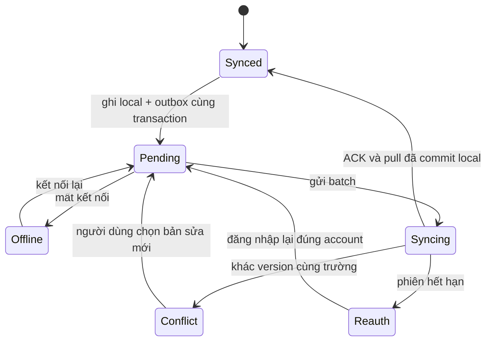
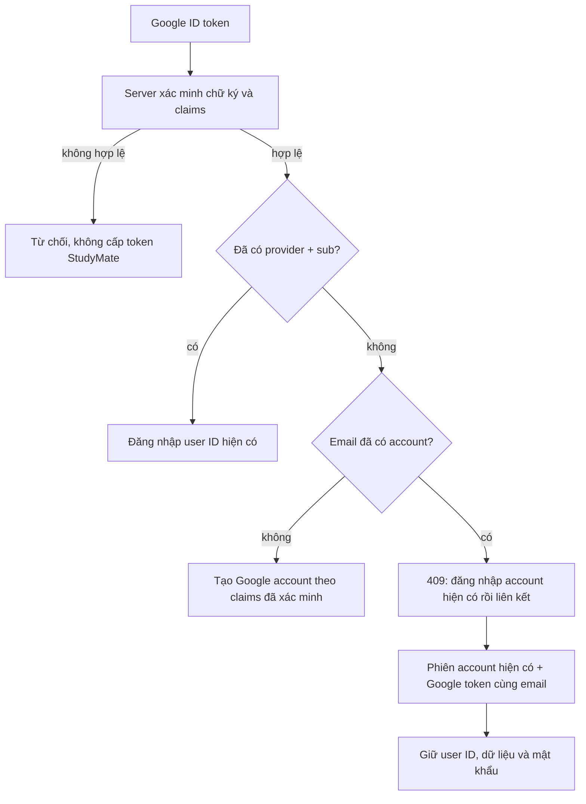

# P0 — Luồng và wireframe cho web/Flutter

Các khung dưới đây là thiết kế cho P1/P2, không phải màn hình mới đã được cài vào ứng dụng. Giữ cùng tên và ý nghĩa trạng thái trên React và Flutter.

## 1. Timer gắn nhiệm vụ

```text
┌ Phiên tập trung ─────────────────────────┐
│ Nhiệm vụ: Ôn chương 2          [Đổi]     │
│ Môn: Cơ sở dữ liệu (từ nhiệm vụ)         │
│                  25:00                  │
│            [Bắt đầu tập trung]          │
│ Đã đồng bộ / Sẽ lưu khi có mạng          │
└─────────────────────────────────────────┘
```

Idle → Running → Paused → Running → Completed/Stopped. Pause đóng segment đang chạy; resume mở segment mới. Stop hỏi lưu thời gian đã học hoặc bỏ phiên; bỏ phiên không xóa giờ các phiên khác. Khi đã có nhiệm vụ, môn không chọn độc lập gây sai thống kê.

Mất mạng: vẫn chạy/lưu trong DB thiết bị. Khởi động lại: phục hồi từ mốc đã lưu, hỏi xử lý khoảng gián đoạn nếu không chứng minh được đang tập trung. Hai máy cùng chạy: cảnh báo và có bước đối soát; không mặc định nhân đôi giờ.

## 2. Trạng thái đồng bộ

```text
┌ Trang chủ ──────────────────────────────┐
│ Mất mạng · 3 thay đổi chờ gửi   [Xem]   │
│ Việc cần làm hôm nay                    │
│ [ ] Ôn chương 2                         │
│ [✓] Làm bài tập · Chưa đồng bộ          │
│ Tổng giờ: 2,4 · Có dữ liệu chờ xác nhận  │
└─────────────────────────────────────────┘
```



Không hiện “Đã đồng bộ” chỉ vì POST thành công; cần xác nhận mutation và ghi được trạng thái/cursor xuống DB. Đổi tài khoản khi còn outbox phải giải thích và cho giữ bản nháp, không tự bỏ.

## 3. Giải quyết xung đột

```text
┌ Nhiệm vụ được sửa trên hai thiết bị ─────┐
│ Bản trên máy          Bản đã đồng bộ     │
│ Trạng thái: Xong      Trạng thái: Đang làm│
│ Hạn: 12/11            Hạn: 13/11         │
│ [Giữ bản trên máy]    [Dùng bản đã đồng bộ]│
│ [Sửa kết hợp]                            │
└──────────────────────────────────────────┘
```

Desktop hiển thị hai cột; mobile hiển thị hai phần nối tiếp với cùng nhãn. Chọn một phương án tạo mutation mới với baseVersion hiện tại. Nội dung gốc giữ lại cho đến khi mutation được ACK; lỗi mạng không làm mất lựa chọn. Với ghi chú có thêm “Lưu thành hai ghi chú”.

## 4. Đăng nhập và liên kết Google



Nút Facebook mẫu bị gỡ. Nếu SDK/config không tải được, hiện lỗi và nút thử lại; form email vẫn dùng được. Thất bại xác minh Google khi đang liên kết không đăng xuất phiên StudyMate hiện tại.
